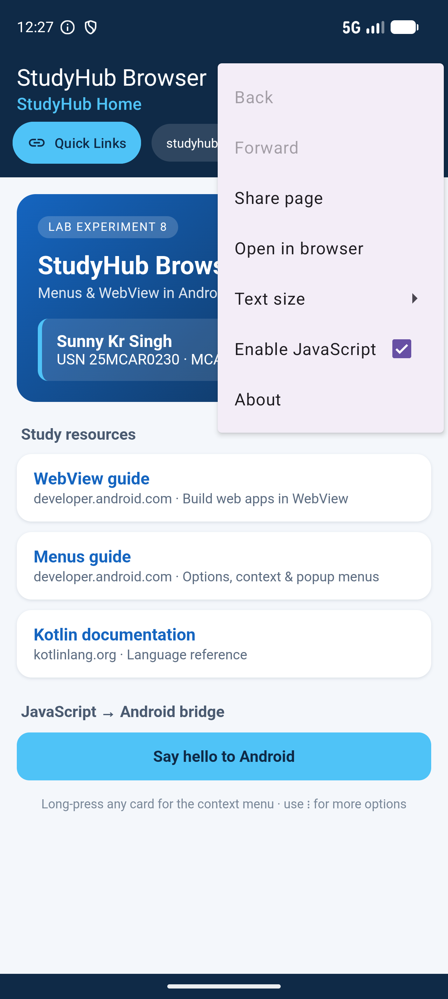
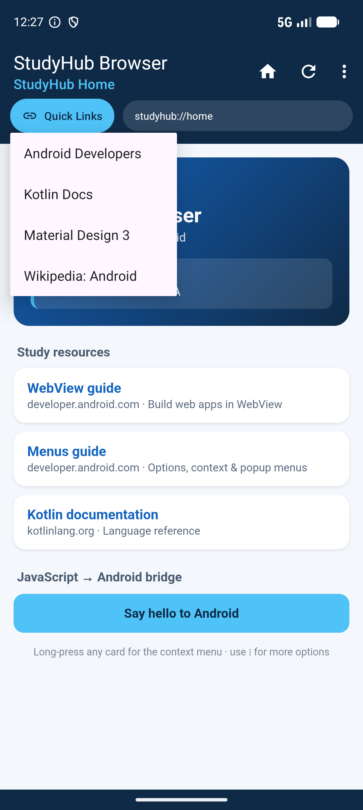
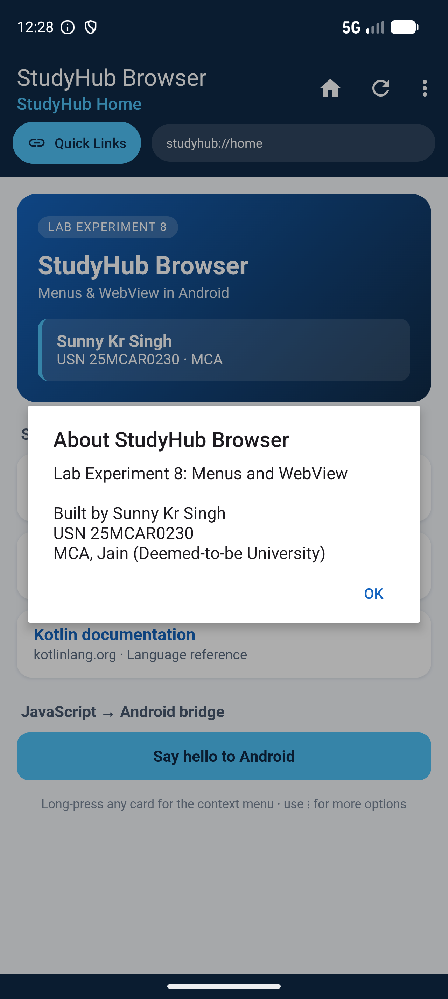
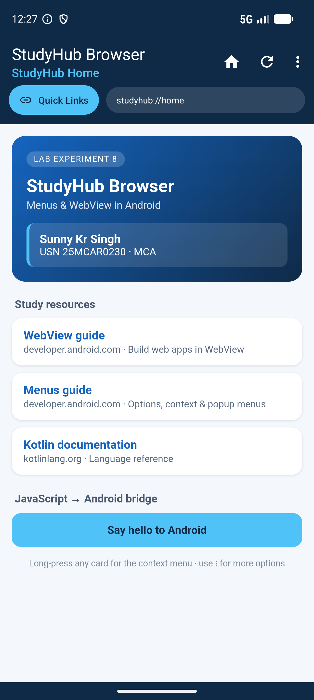
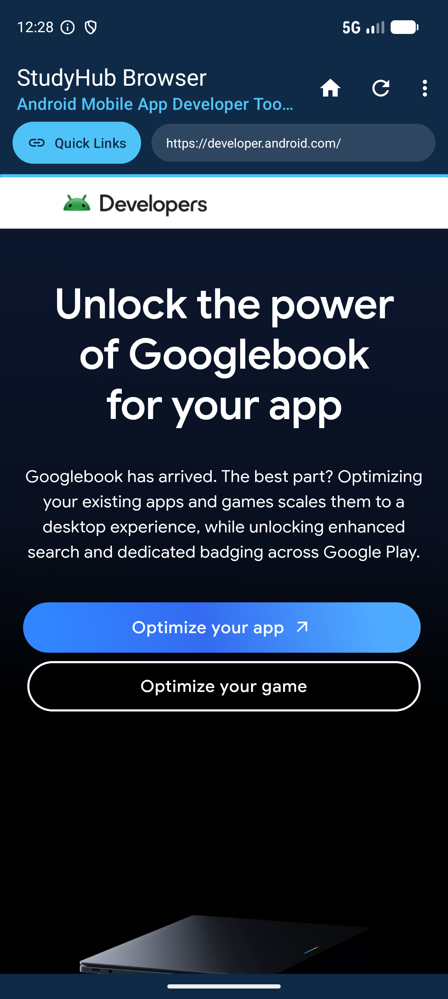
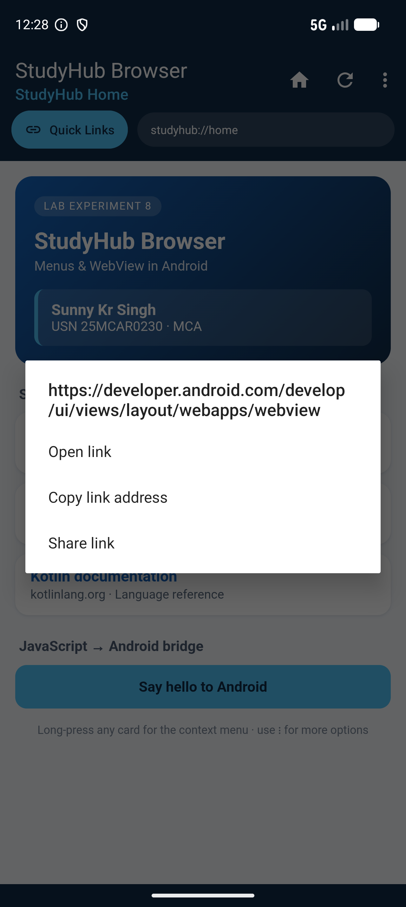

# Lab 08 — Implement Menus and WebView in an Android Application

## Aim
To build an Android application that uses all three Android menu types (**Options menu**, **Context menu** and **Popup menu**) to control an embedded **WebView**: loading a local HTML page and live websites inside the app, handling navigation, and talking from JavaScript back to Kotlin.

## Concept / Technology Used
- Android Studio
- Kotlin
- XML Views (no Jetpack Compose)

### Menus
Android defines menus as XML resources under `res/menu/` and inflates them at runtime with `MenuInflater`.

| Menu type | How it is shown | How it is used here |
|---|---|---|
| **Options menu** | App bar (`MaterialToolbar` set with `setSupportActionBar()`). Items with `showAsAction="ifRoom"` appear as icons; the others go into the overflow (⋮). | `onCreateOptionsMenu()` inflates `menu_main.xml`. `onOptionsItemSelected()` handles Home, Refresh, Back, Forward, Share page, Open in browser, About. `onPrepareOptionsMenu()` enables or disables Back/Forward based on WebView history. |
| ↳ **Sub-menu + checkable group** | A nested `<menu>` inside an `<item>` | **Text size** has a radio group (`checkableBehavior="single"`) that sets `WebSettings.textZoom` to 80 / 100 / 130 %. |
| ↳ **Checkable item** | `android:checkable="true"` | **Enable JavaScript** turns `WebSettings.javaScriptEnabled` on and off. |
| **Context menu** (floating) | Long-press on a view registered with `registerForContextMenu()` | Long-pressing inside the WebView calls `onCreateContextMenu()`. `WebView.hitTestResult` checks whether a link is under the finger. On a link, the menu offers *Open link / Copy link address / Share link*; anywhere else it offers *Reload page / Copy page URL*. |
| **Popup menu** | `PopupMenu` anchored to a view | The **Quick Links** button opens `menu_quick_links.xml` with links to Android Developers, Kotlin Docs, Material Design 3 and Wikipedia. |

### WebView
`WebView` is a `View` that renders web content with the system Chromium engine, inside your own Activity.
- `loadUrl("file:///android_asset/home.html")` loads a **local HTML page** bundled in `assets/`. `loadUrl("https://…")` loads **remote pages**, which requires the `INTERNET` permission in the manifest.
- `WebSettings`: JavaScript, DOM storage, wide viewport, pinch zoom and text zoom.
- **`WebViewClient`**: `shouldOverrideUrlLoading()` keeps `http(s)` links inside the app and hands `mailto:`, `tel:` etc. to the system. `onPageStarted()` and `onPageFinished()` update the URL bar. `onReceivedError()` shows an offline page. `doUpdateVisitedHistory()` keeps the Back handler in sync.
- **`WebChromeClient`**: `onProgressChanged()` drives the `LinearProgressIndicator`, and `onReceivedTitle()` shows the page title as the toolbar subtitle.
- **JavaScript → Kotlin bridge**: `addJavascriptInterface(WebAppInterface(this), "Android")` exposes a method marked `@JavascriptInterface`. The home page's button calls `Android.showToast(...)`, which shows a native Toast.
- **Back navigation**: an `OnBackPressedCallback` calls `webView.goBack()` while `canGoBack()` is true, then lets the system close the app.
- **State**: `saveState()` / `restoreState()` keep the current page across Activity recreation.

## Scenario
**StudyHub Browser** is a small in-app study browser for an MCA student.

1. On launch, the WebView loads a **local home page** (`assets/home.html`). The page shows the experiment title, the student's **name and USN**, cards linking to the Android WebView guide, the Android Menus guide and the Kotlin docs, and a **"Say hello to Android"** button that calls Kotlin through the JavaScript interface.
2. The **toolbar options menu** controls the browser. Home and Refresh are action icons; the ⋮ overflow holds Back, Forward, Share page, Open in browser, a **Text size** sub-menu, an **Enable JavaScript** toggle and **About**. The About dialog repeats the name and USN.
3. The **Quick Links popup menu** jumps straight to popular developer sites. They load inside the app with a progress bar, and the page title and URL appear in the toolbar.
4. **Long-pressing a link** in the page opens a **context menu** for that link (open, copy, share). Long-pressing empty space gives page actions instead (reload, copy URL).

## Folder Structure
```
Lab08MenusWebViewDemo/
├── app/
│   ├── build.gradle.kts
│   └── src/
│       ├── main/
│       │   ├── AndroidManifest.xml              # INTERNET permission + MainActivity
│       │   ├── assets/
│       │   │   └── home.html                    # local start page (name, USN, study links, JS button)
│       │   ├── java/com/example/lab08menuswebviewdemo/
│       │   │   ├── MainActivity.kt              # WebView setup + options, popup and context menus
│       │   │   └── WebAppInterface.kt           # @JavascriptInterface bridge (JS → Toast)
│       │   └── res/
│       │       ├── layout/
│       │       │   └── activity_main.xml        # Toolbar, Quick Links button, URL bar, progress bar, WebView
│       │       ├── menu/
│       │       │   ├── menu_main.xml            # options menu (action items, overflow, sub-menu, checkable)
│       │       │   ├── menu_quick_links.xml     # popup menu
│       │       │   ├── menu_context_link.xml    # context menu for a long-pressed link
│       │       │   └── menu_context_page.xml    # context menu for the rest of the page
│       │       ├── drawable/
│       │       │   ├── ic_home.xml, ic_refresh.xml, ic_link.xml   # vector icons
│       │       │   └── bg_url_pill.xml                            # rounded URL bar background
│       │       └── values/
│       │           ├── colors.xml, strings.xml, themes.xml
│       └── test/java/com/example/lab08menuswebviewdemo/ExampleUnitTest.kt
├── gradle/
├── screenshots/
│   ├── output.png
│   ├── popup.png
│   ├── about_dialog.png
│   ├── test_case_1.png
│   ├── test_case_2.png
│   └── test_case_3.png
├── build.gradle.kts
├── settings.gradle.kts
└── README.md
```

## How to Run
1. Clone this repository to your local machine.
2. Open Android Studio and select **Open**, then navigate to and select the `Lab08MenusWebViewDemo` folder.
3. Wait for Gradle to sync the project (Android Studio will do this automatically).
4. Select an emulator or device **with internet access**. The local home page works offline, but Quick Links need the network.
5. Click **Run ▶** to build and launch the app.

## Output
  

*Left: the options menu overflow with the Text size sub-menu and the checkable "Enable JavaScript" item. Centre: the Quick Links popup menu. Right: the About dialog opened from the options menu.*

## Test Cases

| Test Case | Description | Expected Result | Screenshot |
|-----------|-------------|------------------|------------|
| Test Case 1 | Launch the app (name & USN) | The WebView loads the local `home.html` from `assets/`. The toolbar subtitle shows the page title "StudyHub Home", the URL bar shows `studyhub://home`, and the page shows **Sunny Kr Singh · USN 25MCAR0230** with the study resource cards |  |
| Test Case 2 | Tap **Quick Links** (popup menu) → **Android Developers** | `developer.android.com` loads **inside the app** (not in an external browser). The progress bar animates, the URL bar shows `https://developer.android.com/`, and the toolbar subtitle changes to the page's title |  |
| Test Case 3 | Tap **Home** (options menu), then **long-press** the "WebView guide" card | A floating **context menu** appears. Its header is the link's URL, taken from `WebView.hitTestResult`, and it lists *Open link*, *Copy link address* and *Share link* |  |

## Conclusion
This experiment showed how Android's three menu types fit together around a `WebView`.
- The **options menu** in the app bar provides global browser actions, including a sub-menu with a single-choice group and a checkable toggle.
- The **popup menu** offers quick actions tied to one button.
- The **context menu** offers actions for whatever was long-pressed, and `WebView.hitTestResult` makes those actions link-aware.

On the WebView side, the app loads both bundled and remote content. It keeps navigation in-app with a `WebViewClient`, reports progress and titles through a `WebChromeClient`, handles the system Back gesture, and passes calls from page JavaScript to native Kotlin through a `@JavascriptInterface`.
