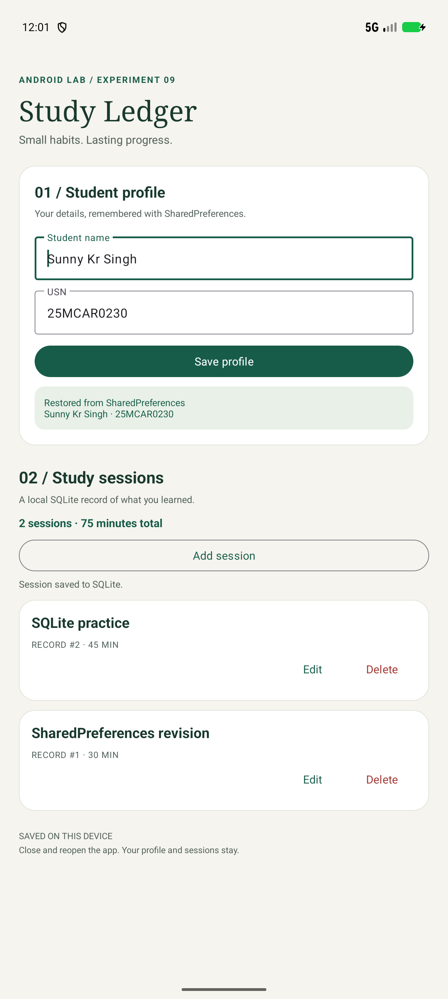
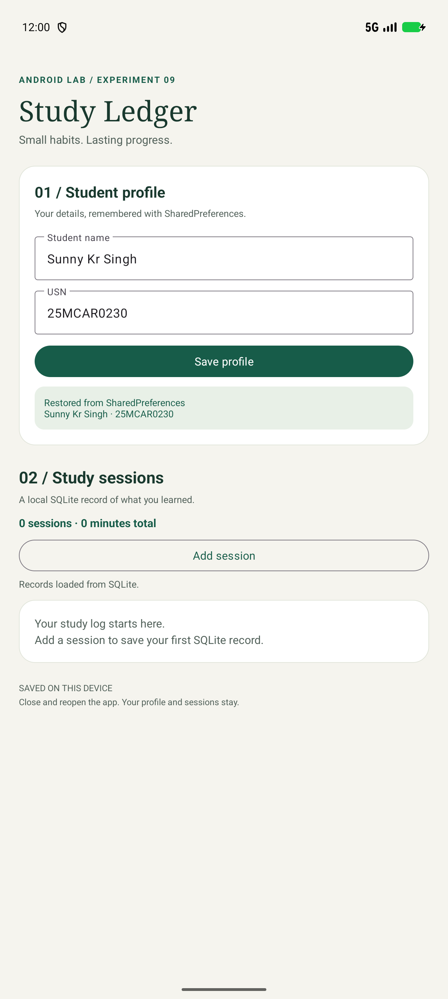
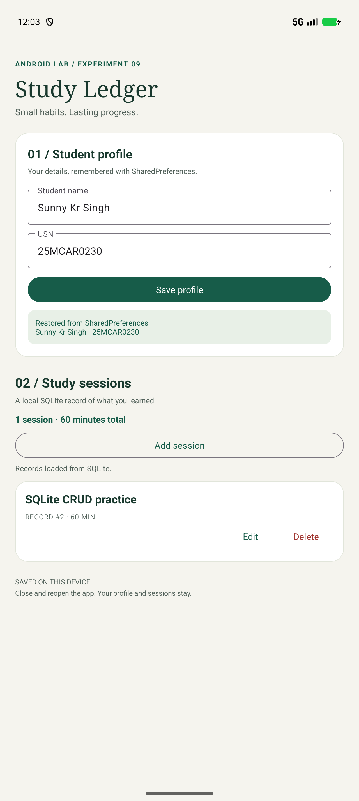

# Lab 09 — Data Persistence using SharedPreferences and SQLite

**Student:** Sunny Kr Singh

**USN:** 25MCAR0230

**Scenario:** Study Ledger — a student's offline profile and study log.

## Aim

Develop an Android application that stores small key-value data using **SharedPreferences** and structured records using **SQLite**, then demonstrate that both survive closing and reopening the application.

## Concept / Technology Used

- Kotlin and XML Views, following Labs 7 and 8.
- Material Components for the profile form, session cards and dialogs.
- `SharedPreferences` for the student's name and USN.
- `SQLiteOpenHelper`, `SQLiteDatabase`, `ContentValues` and `Cursor` for persistent study records and CRUD operations.
- A single background executor for storage operations, with results posted to the UI thread.
- Android Studio, Android Gradle Plugin 9.3.1, Gradle 9.5.0 and JDK 21. Minimum SDK 26; compile/target SDK 37.

### SharedPreferences: small key-value data

`ProfilePreferences` opens the private `student_profile` preferences file. The keys `name` and `usn` hold strings. The Save profile action trims the fields, normalizes the USN to uppercase, and writes both values using one editor. This experiment uses `commit()` **on the background executor** so the app reports success only after the disk write succeeds. On a fresh launch, `load()` reads the saved values; an unsaved profile starts empty.

SharedPreferences suits a few simple settings or profile values. Android's [SharedPreferences guide](https://developer.android.com/training/data-storage/shared-preferences) explains its key-value API and the difference between asynchronous `apply()` and synchronous `commit()`.

### SQLite: structured records

`StudyDbHelper` creates `study_ledger.db` at database version 1. Each study session is one row in `sessions`:

| Column | Type / constraint | Purpose |
|---|---|---|
| `id` | `INTEGER PRIMARY KEY AUTOINCREMENT` | Stable record identity |
| `title` | `TEXT NOT NULL`, nonblank | Study topic |
| `minutes` | `INTEGER NOT NULL`, 1–1440 | Duration of the session |

| Operation | App action | Android API |
|---|---|---|
| Create | Add session | `insertOrThrow()` with `ContentValues` |
| Read | Launch or refresh after a change | `query()`, newest ID first; cursor closed with `use` |
| Update | Edit a session's topic or duration | `update()` with `id = ?` and selection arguments |
| Delete | Delete, then confirm | `delete()` with `id = ?` and selection arguments |

Values are passed separately from SQL; user-entered text is never concatenated into a query. The helper validates input, and the table also enforces constraints. Updates and deletions target the record's ID rather than its title. Version 1 does not need a migration; a future schema version must add a migration instead of dropping the student's data. See Android's [SQLite guide](https://developer.android.com/training/data-storage/sqlite).

### What persistence means here

The profile and records are stored in separate private files inside this app's sandbox. They survive Activity recreation, process termination, force-stop and device restart. They are **local to this installation**: clearing app storage or uninstalling removes them. No internet or storage permission is needed. Backup is disabled for this demonstration so reinstalling does not silently restore old test data.

The assignment explicitly asks for SharedPreferences and SQLite, so it uses those APIs directly. Android's guides recommend DataStore and Room respectively for modern applications.

## Scenario

**Study Ledger** helps a student remember their details and track study sessions offline.

1. Enter **Sunny Kr Singh** and **25MCAR0230**, then tap **Save profile**. The status card confirms the values were saved to SharedPreferences.
2. Tap **Add session** and enter a topic and duration. The session is inserted into SQLite, and the list and total minutes refresh.
3. Use **Edit** to change a session or **Delete** to remove it after confirmation.
4. Force-stop and reopen the app. The profile status reads **Restored from SharedPreferences**, and the session list is queried again from SQLite.

The app starts without a prefilled identity or seeded records. The name, USN and sessions in the screenshots were entered through the app, so their reappearance after a restart demonstrates actual saved data.

## Folder Structure

```text
Lab09DataPersistenceDemo/
├── app/
│   ├── build.gradle.kts                 # Android configuration and dependencies
│   └── src/
│       ├── main/
│       │   ├── AndroidManifest.xml      # Launcher activity; no permissions required
│       │   ├── java/com/example/lab09datapersistencedemo/
│       │   │   ├── MainActivity.kt      # Forms, dialogs, rendering and background work
│       │   │   ├── ProfilePreferences.kt # Profile model + SharedPreferences storage
│       │   │   └── StudyDbHelper.kt     # Session model + SQLite schema and CRUD
│       │   └── res/
│       │       ├── layout/
│       │       │   ├── activity_main.xml # Profile form and session list
│       │       │   ├── dialog_session.xml # Add/edit form
│       │       │   └── row_session.xml  # Record card with Edit/Delete actions
│       │       ├── drawable/
│       │       │   ├── bg_card.xml
│       │       │   ├── bg_status.xml
│       │       │   └── ic_ledger.xml   # Launcher icon
│       │       ├── xml/data_extraction_rules.xml # Excludes profile/database from backup and transfer
│       │       └── values/
│       │           ├── strings.xml     # UI text and validation messages
│       │           └── themes.xml      # Material light theme
│       └── androidTest/java/com/example/lab09datapersistencedemo/
│           └── PersistenceTest.kt      # Three tests using real Android storage
├── gradle/
│   ├── libs.versions.toml               # Dependency versions
│   └── wrapper/                        # Gradle wrapper JAR and properties
├── screenshots/
│   ├── output.png
│   ├── test_case_1.png
│   ├── test_case_2.png
│   └── test_case_3.png
├── .gitignore                          # Excludes builds, IDE files and SDK path
├── build.gradle.kts
├── gradle.properties
├── gradlew / gradlew.bat
├── settings.gradle.kts
└── README.md
```

## How to Run

1. Clone this repository and open **Lab09DataPersistenceDemo** in Android Studio, rather than the repository root.
2. Use **JDK 21** for Gradle and install Android SDK Platform **37**. Android Studio creates `local.properties` for your SDK location; it is intentionally not committed.
3. Sync Gradle. The first sync needs internet to download dependencies.
4. Select an emulator/device running Android 8.0 / API 26 or newer and press **Run**.
5. Save a profile and create study sessions. To verify persistence, use Android Settings → Apps → Study Ledger → **Force stop**, then reopen the app from its launcher icon. Do **not** clear storage between these steps.

From PowerShell in the project directory:

```powershell
.\gradlew.bat assembleDebug
.\gradlew.bat connectedDebugAndroidTest
```

The automated tests clear **this app's** profile and database before and after each test. Run them on a dedicated test emulator before entering the screenshot data.

## Output



The main screen displays the student profile, study-session records, total duration and CRUD controls.

## Test Cases

Run these three cases **in order**, starting from a fresh installation or cleared app storage. Each restart below means force-stop and relaunch, not just minimizing the app. Screenshot 1 explicitly includes the student's name and USN.

| Test case | Steps / input | Expected result | Screenshot |
|---|---|---|---|
| **1. SharedPreferences persistence — name & USN** | Enter `Sunny Kr Singh` and `25MCAR0230`; tap **Save profile**; force-stop and relaunch. | Both fields retain their values. The status reads **Restored from SharedPreferences**, with **Sunny Kr Singh · 25MCAR0230**. No sessions exist yet. |  |
| **2. SQLite insert/read persistence** | Add `SharedPreferences revision` for `30` minutes and `SQLite practice` for `45` minutes; force-stop and relaunch. | Both records appear, newest first, with their original IDs and values; summary shows **2 sessions · 75 minutes total**. |  |
| **3. SQLite update/delete persistence** | Edit `SQLite practice` to `SQLite CRUD practice`, `60` minutes. Delete `SharedPreferences revision` and confirm. Force-stop and relaunch. | Exactly one record remains with the edited title and duration; summary shows **1 session · 60 minutes total**. The removed record does not reappear. |  |

### Automated coverage

`PersistenceTest.kt` tests the actual app storage classes on Android:

1. Save and reload a normalized profile through a new store instance; reject a blank name without overwriting saved data.
2. Insert two records, close the database helper, reopen it and verify IDs, values and ordering.
3. Update one record and delete another, then reopen and verify the remaining row. Also check missing IDs and reject empty topics and invalid durations.

These tests complement the screenshots: the automated tests reopen storage objects, while the screenshot walkthrough also restarts the entire app process.

### Verification performed

Verified on **16 October 2026**, using the **Pixel 10 Pro emulator, Android 17 / API 37**:

- Debug APK and instrumentation APK built successfully.
- All **3 instrumentation tests passed**, with no failures or skipped tests.
- Android lint passed with no errors; the remaining two warnings advise upgrading dependency versions retained from the previous lab.
- All three manual test cases above passed after force-stop and cold launch. The four PNGs are actual emulator captures.

```powershell
.\gradlew.bat assembleDebug assembleDebugAndroidTest lintDebug connectedDebugAndroidTest
```

The screenshots use the emulator's 1280 × 2856 display at 360 dpi to show the profile and session list together. On the normal phone density or a smaller screen, the content scrolls vertically.

## Conclusion

This experiment demonstrates two forms of Android data persistence in one scenario. SharedPreferences remembers the student's small profile, while SQLite stores a collection of study sessions with create, read, update and delete operations. Reopening the app retrieves both stores from disk, including previous edits and deletions.
