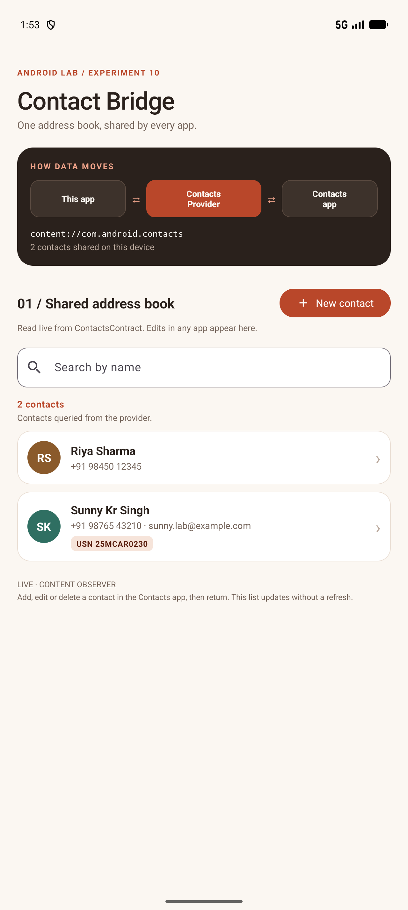
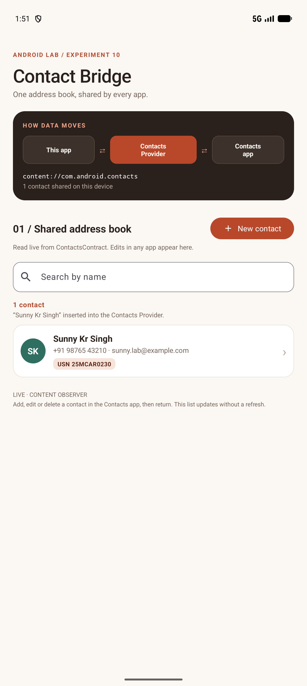
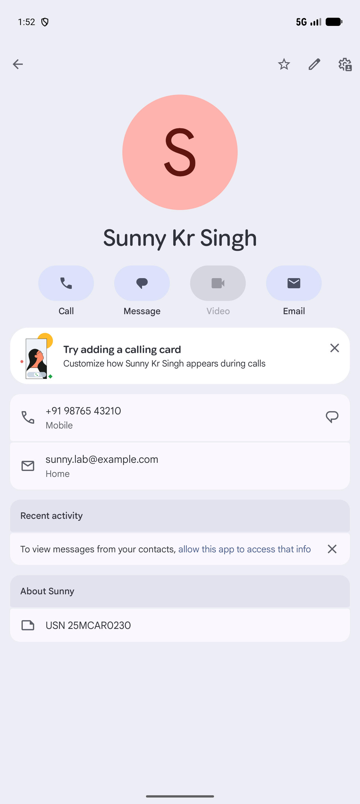
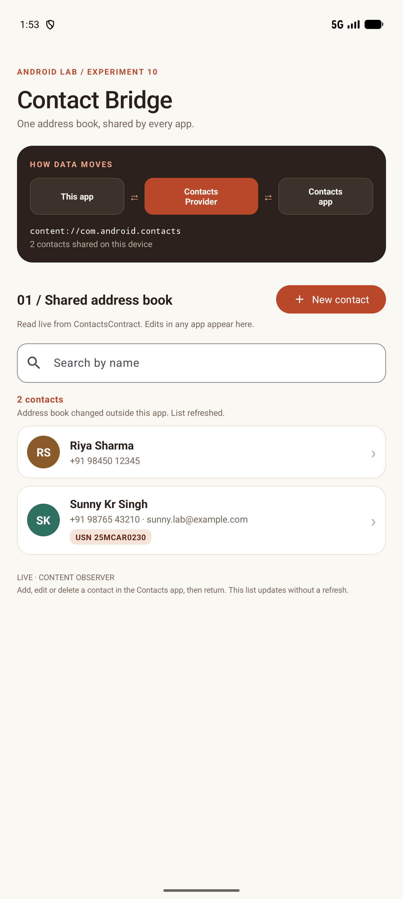

# Lab 10 — Data Sharing using the Contacts Content Provider

**Student:** Sunny Kr Singh

**USN:** 25MCAR0230

**Scenario:** Contact Bridge — one address book, shared by every app on the device.

## Aim

Develop an Android application that shares data with other applications through the **Contacts Content Provider**. The app reads, searches, inserts and deletes contacts using `ContentResolver` and `ContactsContract`. It also shows that changes made by this app appear in the system Contacts app, and changes made there appear in this app.

## Concept / Technology Used

- Kotlin and XML Views, following Labs 7–9.
- Material Components: bottom sheets for the contact form and detail view, plus text fields, buttons and an alert dialog.
- `ContentResolver`, `ContactsContract`, `ContentProviderOperation` and `Cursor` for provider access.
- `ContentObserver` for live updates when another app changes the address book.
- Runtime permissions through the Activity Result API (`RequestMultiplePermissions`).
- A single background executor for provider calls, with results posted to the UI thread.
- Android Studio, Android Gradle Plugin 9.3.1, Gradle 9.5.0 and JDK 21. Minimum SDK 26; compile/target SDK 37.

### Content Providers: Android's data-sharing layer

Each Android app runs in its own sandbox and cannot open another app's files or databases. A **Content Provider** is the standard way for an app to expose structured data to other apps. Clients do not talk to the provider object directly. They call a `ContentResolver` with a `content://` URI. Android routes the call to the provider that owns the URI's *authority*, checks the caller's permissions, and returns a `Cursor` or result.

```text
Contact Bridge ──ContentResolver──▶ content://com.android.contacts ◀──ContentResolver── Contacts app
                                    (Contacts Provider, one shared database)
```

The Contacts Provider (authority `com.android.contacts`) is the system's shared address book. Phone, messaging and email apps all read from it, so a contact written here can be used by every app with Contacts access. See Android's [Content provider basics](https://developer.android.com/guide/topics/providers/content-provider-basics) and [Contacts Provider](https://developer.android.com/identity/providers/contacts-provider) guides.

### The ContactsContract data model

The provider stores contacts in three tables:

| Table | URI constant | What a row represents |
|---|---|---|
| `Contacts` | `Contacts.CONTENT_URI` | One person as the user sees them, combining one or more raw contacts |
| `RawContacts` | `RawContacts.CONTENT_URI` | One person's data from a single account (here a local, device-only account) |
| `Data` | `Data.CONTENT_URI` | One piece of information: name, phone number, email, note… identified by `MIMETYPE` |

### Operations used in this app

| Operation | App action | Android API |
|---|---|---|
| Read | Launch, refresh, live update | `query(Contacts.CONTENT_URI)` for names, then one `query(Data.CONTENT_URI)` with `MIMETYPE IN (?, ?, ?)` for phones, emails and notes |
| Search | Type in *Search by name* | `query()` on `Contacts.CONTENT_FILTER_URI` with the encoded search text, so the provider does the matching |
| Insert | *New contact* → *Save to Contacts* | `applyBatch()`: one `RawContacts` insert plus `StructuredName`, `Phone`, `Email` and `Note` `Data` inserts. `withValueBackReference()` links each data row to the new raw contact |
| Delete | Contact sheet → *Delete from device* → confirm | `delete()` on the contact's **lookup URI**, which still resolves if the provider has re-aggregated the contact |
| Observe | Edit contacts in another app | `registerContentObserver(Contacts.CONTENT_URI, true, …)`; a burst of change notifications triggers one debounced reload |
| Share out | *Open in Contacts app* / *Share details* | `ACTION_VIEW` with the lookup URI opens the same row in the system Contacts app; `ACTION_SEND` shares the details as text |

The batch insert is **atomic**: if any row fails, none are written, so no half-created contacts remain. Search text and IDs are passed as URI segments or selection arguments, never concatenated into SQL. All provider calls run off the main thread, and cursors are closed with `use`.

### Permissions

`READ_CONTACTS` and `WRITE_CONTACTS` are *dangerous* permissions, so the app must declare them in the manifest **and** request them at runtime. Until the user allows access, the app shows a permission card and disables its actions. If the user denies the request twice, Android stops showing the dialog. The card then offers **Open settings**, and the app picks up the change when the user returns.

The app keeps no data of its own; every contact lives in the shared provider. Backup is therefore disabled.

## Scenario

**Contact Bridge** shows one address book through two apps:

1. On first launch the app asks for Contacts access. The dark *How data moves* card shows the path: **This app ⇄ Contacts Provider ⇄ Contacts app**, with the provider URI and a live contact count.
2. Tap **New contact** and save **Sunny Kr Singh** with a phone number, an email and the note **USN 25MCAR0230**. The contact is inserted into the provider and listed with its USN note.
3. Tap the contact, then **Open in Contacts app**. The system Contacts app shows the same name, phone, email and USN, read from the same provider row.
4. Create **Riya Sharma** in the system Contacts app and return. Contact Bridge's `ContentObserver` detects the change and refreshes the list automatically, with the status *Address book changed outside this app*.

The demonstration emulator starts with an **empty** address book; every contact in the screenshots was created during this walkthrough. The phone numbers and email are sample values.

## Folder Structure

```text
Lab10ContactsProviderDemo/
├── app/
│   ├── build.gradle.kts                  # Android configuration and dependencies
│   └── src/
│       ├── main/
│       │   ├── AndroidManifest.xml       # READ/WRITE_CONTACTS permissions, launcher activity
│       │   ├── java/com/example/lab10contactsproviderdemo/
│       │   │   ├── MainActivity.kt       # Permissions, observer, list rendering, sheets, intents
│       │   │   └── ContactsRepository.kt # DeviceContact model + all ContactsContract queries and writes
│       │   └── res/
│       │       ├── layout/
│       │       │   ├── activity_main.xml     # Header, data-flow card, permission card, search, list
│       │       │   ├── row_contact.xml       # Contact card: avatar, name, phone · email, note chip
│       │       │   ├── sheet_new_contact.xml # Bottom-sheet insert form
│       │       │   └── sheet_contact.xml     # Bottom-sheet detail view: open, share, delete
│       │       ├── drawable/                 # Card/chip/avatar shapes, icons, launcher icon (ic_bridge)
│       │       ├── xml/data_extraction_rules.xml # Disables backup; the app stores no data of its own
│       │       └── values/
│       │           ├── strings.xml       # UI text, plurals and validation messages
│       │           ├── styles.xml        # Data-flow node, arrow and avatar styles
│       │           └── themes.xml        # Material 3 light theme, terracotta palette
│       └── androidTest/java/com/example/lab10contactsproviderdemo/
│           └── ContactsProviderTest.kt   # Three tests against the real Contacts Provider
├── gradle/
│   ├── libs.versions.toml                # Dependency versions
│   └── wrapper/                          # Gradle wrapper JAR and properties
├── screenshots/
│   ├── output.png
│   ├── test_case_1.png
│   ├── test_case_2.png
│   └── test_case_3.png
├── .gitignore                            # Excludes builds, IDE files and SDK path
├── build.gradle.kts
├── gradle.properties
├── gradlew / gradlew.bat
├── settings.gradle.kts
└── README.md
```

## How to Run

1. Clone this repository and open **Lab10ContactsProviderDemo** in Android Studio, rather than the repository root.
2. Use **JDK 21** for Gradle and install Android SDK Platform **37**. Android Studio creates `local.properties` for your SDK location; it is intentionally not committed.
3. Sync Gradle. The first sync needs internet to download dependencies.
4. Select an emulator/device running Android 8.0 / API 26 or newer and press **Run**. The device needs a Contacts app (any Google Play system image includes one).
5. Tap **Allow** when Android asks for Contacts access.

From PowerShell in the project directory:

```powershell
.\gradlew.bat assembleDebug
.\gradlew.bat connectedDebugAndroidTest
```

The automated tests grant the Contacts permissions themselves. They create contacts whose names start with `ZZTest` and delete them afterwards, so other contacts on the device are not touched. A dedicated test emulator is still recommended.

## Output



The main screen shows the data-flow card with the provider URI and contact count, the search field, and both contacts queried from the provider. One contact was inserted by this app; the other was created in the system Contacts app.

## Test Cases

Run these three cases **in order** on a device with Contacts access allowed. Screenshot 1 shows the student's name and USN.

| Test case | Steps / input | Expected result | Screenshot |
|---|---|---|---|
| **1. Insert through the provider — name & USN** | Tap **New contact**. Enter `Sunny Kr Singh`, `+91 98765 43210`, `sunny.lab@example.com`, note `USN 25MCAR0230`; tap **Save to Contacts**. | The sheet closes. Status reads **“Sunny Kr Singh” inserted into the Contacts Provider**. The card shows the phone, email and a **USN 25MCAR0230** chip; the provider count reads **1 contact shared on this device**. |  |
| **2. Data shared out to the Contacts app** | Tap **Sunny Kr Singh** → **Open in Contacts app**. | The **system Contacts app** opens the same contact, with the name, mobile number, email and *About* note **USN 25MCAR0230** written by Contact Bridge. |  |
| **3. Data shared in from the Contacts app (live)** | In the Contacts app, create `Riya Sharma`, `+91 98450 12345`, then tap **Save**. Return to Contact Bridge **without refreshing**. | Riya Sharma appears automatically, sorted by name, and the count becomes **2 contacts**. Status reads **Address book changed outside this app. List refreshed.** |  |

### Automated coverage

`ContactsProviderTest.kt` runs on Android against the real Contacts Provider, with the permissions granted by `GrantPermissionRule`:

1. Insert a contact with a phone, email and USN note, then read it back and verify every data row.
2. Insert a contact, then query `Contacts.CONTENT_URI` **directly through `ContentResolver`**, as any other app would, bypassing the app's repository. Also verify that the provider's name filter finds the contact and that a non-matching filter excludes it.
3. Delete a contact by lookup URI and verify it is gone and that a second delete affects 0 rows. Also verify that a blank name, an invalid phone number and an invalid email are rejected before anything is written.

### Verification performed

Verified on **26 October 2026**, using the **Pixel 10 Pro emulator, Android 17 / API 37**:

- Debug APK and instrumentation APK built successfully.
- All **3 instrumentation tests passed**, with no failures or skipped tests.
- Android lint passed with no errors. The remaining two warnings advise upgrading the dependency versions shared with the previous labs.
- All three manual test cases above passed, along with a search for `riya` (**1 match for “riya”**). The four PNGs are actual emulator captures.

```powershell
.\gradlew.bat assembleDebug assembleDebugAndroidTest lintDebug connectedDebugAndroidTest
```

The screenshots use the emulator's 1280 × 2856 display at 360 dpi, matching Lab 9.

## Conclusion

This experiment demonstrates data sharing between Android apps through a Content Provider. Contact Bridge never opens the contacts database directly. It sends every read, search, insert and delete through `ContentResolver` to the system Contacts Provider, guarded by runtime permissions. The same records are visible in the system Contacts app, and with a `ContentObserver`, changes made there appear in this app straight away.
