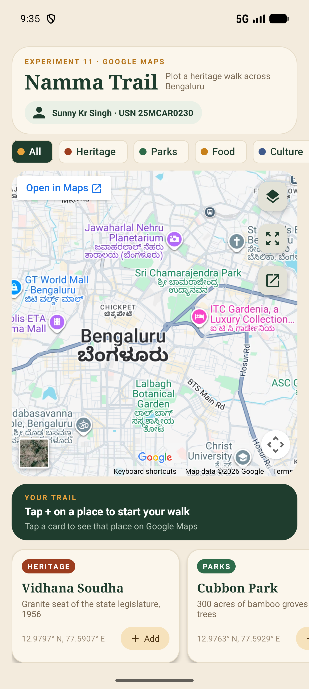
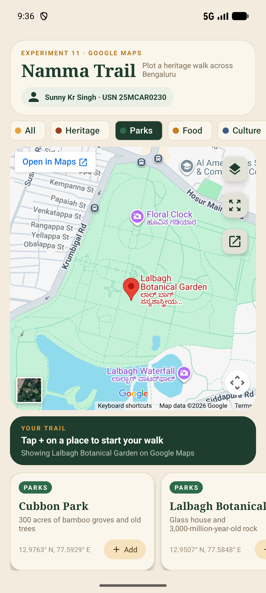
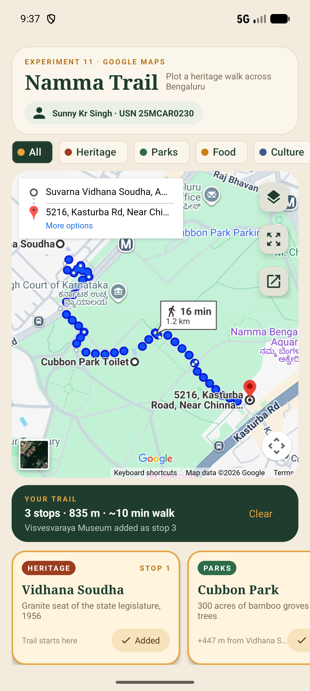
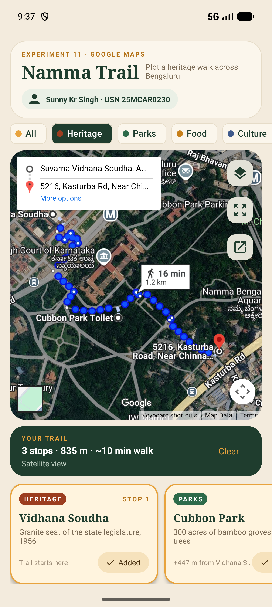

# Lab 11 — Displaying Google Maps

**Student:** Sunny Kr Singh

**USN:** 25MCAR0230

**Scenario:** Namma Trail — plan a heritage walk across central Bengaluru on Google Maps.

## Aim

Develop an Android application that displays **Google Maps**. The app shows a live, interactive Google Map inside the app. Users can open any of twelve Bengaluru landmarks on the map, build a walking trail that Google Maps routes on foot, switch between map, satellite and terrain views, and hand the route to the full Google Maps app.

## Concept / Technology Used

- Kotlin and XML Views, following Labs 7–10.
- **Google Maps Embed** (keyless `output=embed` URLs) rendered in an Android **`WebView`**.
- **Google Maps URLs** (`api=1`) with an `ACTION_VIEW` intent to open the same place or route in the Google Maps app.
- Material Components: filter chips, floating action buttons, tonal buttons and a linear progress indicator.
- Android Studio, Android Gradle Plugin 9.3.1, Gradle 9.5.0 and JDK 21. Minimum SDK 26; compile/target SDK 37.

### Why the embedded map, not the Maps SDK

Android has two common ways to show Google Maps in an app:

| | Maps SDK for Android | Google Maps Embed in a WebView (used here) |
|---|---|---|
| Needs | An API key from a Google Cloud project **with a billing account** (card required) | Nothing: no key, no billing, no Google Play services |
| Map content | Drawn by the app: markers, polylines and styles in Kotlin | Drawn by Google: places, walking directions, satellite and terrain |
| Interaction | Native gestures | Google's own web map: pan, pinch-zoom, place cards, full-screen |

Creating a Maps SDK key requires adding a payment card to Google Cloud, which is not practical for a student lab. The embed approach still shows real Google Maps tiles, places and routes, and it works on any device with a WebView and internet access.

### How the map gets onto the screen

```text
Card / chip / button tap
        │
        ▼
GoogleMapsUrls.embed(trail, focus, mapType)       ← Trail.kt builds the URL
        │   https://maps.google.com/maps?…&output=embed
        ▼
WebView.loadDataWithBaseURL(wrapper page)         ← MainActivity.showMap()
        │   <iframe src="…embed URL…">
        ▼
Google Maps renders the place, route or overview inside the app
```

Google's embed page only renders inside an `<iframe>`; loaded directly it shows *"must be used in an iframe"*. `showMap()` therefore wraps the URL in a one-line full-screen HTML page and loads it with an `https` base URL. JavaScript is enabled for Google's map page, but no JavaScript interface is exposed to it.

### Google Maps URLs used

| What the map shows | When | URL parameters |
|---|---|---|
| City overview | App start, empty trail | `ll=12.9680,77.5850&z=13` |
| One place, with Google's red marker | Tap a card, or a trail with one stop | `q=<name>, Bengaluru&ll=<lat,lng>&z=16` |
| Walking route through every stop | Trail with 2+ stops | `saddr=<stop 1>&daddr=<stop 2>+to:<stop 3>…&dirflg=w` (walking) |
| Map type | Layers button | `t=m` map, `t=h` satellite with labels, `t=p` terrain |
| Open in the Google Maps app | ↗ button | `google.com/maps/dir/?api=1&origin=…&destination=…&waypoints=…&travelmode=walking` |

Every embed URL also ends in `&hl=en&output=embed`.

### Other parts of the app

- **Trail distance:** the trail bar shows a straight-line estimate from the **haversine formula** (great-circle distance on a sphere of radius 6,371 km) at 4.8 km/h walking pace. Google's route on the map shows the real street distance, which is longer.
- **Links leaving the map:** *Open in Maps* and *View larger map* inside the embed are opened in the Google Maps app or browser by `shouldOverrideUrlLoading()`, so the WebView never leaves the app's page.
- **Offline handling:** if Google's map page fails to load, a *Retry* card replaces it.
- **State:** the trail, focused place, filter and map type survive rotation through `onSaveInstanceState()`.
- **Permission:** only `INTERNET`. No location or other dangerous permissions are needed.

## Scenario

**Namma Trail** (*namma* means "our" in Kannada) is a walking-tour planner for central Bengaluru:

1. The app opens on a Google Map of central Bengaluru. The header shows the student's name and USN, and twelve landmarks appear as cards under four categories: **Heritage**, **Parks**, **Food** and **Culture**.
2. Tapping a card shows that place on Google Maps, with Google's red marker.
3. **Add** builds a trail. With two or more stops, Google Maps draws the **walking route** through them in order, with its own time and distance. The dark trail bar shows the number of stops and a straight-line estimate, and each card shows its stop number and leg distance.
4. The filter chips narrow the cards to one category. Trail stops stay listed so the route's stops are always reachable.
5. The layers button switches between map, satellite and terrain, and the ↗ button opens the same route in the Google Maps app.

Landmark coordinates are approximate and are used for demonstration only.

## Folder Structure

```text
Lab11GoogleMapsDemo/
├── app/
│   ├── build.gradle.kts                  # Android configuration and dependencies
│   └── src/
│       ├── main/
│       │   ├── AndroidManifest.xml       # INTERNET permission, launcher activity, https <queries>
│       │   ├── java/com/example/lab11googlemapsdemo/
│       │   │   ├── MainActivity.kt       # WebView map, cards, filters, trail, map type, external links
│       │   │   └── Trail.kt              # Place/Category model, 12 landmarks, haversine math, Google Maps URLs
│       │   └── res/
│       │       ├── layout/
│       │       │   ├── activity_main.xml # Header, chips, rounded map window + controls, trail bar, carousel
│       │       │   ├── row_place.xml     # Place card: category pill, stop badge, distance, Add button
│       │       │   └── chip_filter.xml   # Category filter chip
│       │       ├── drawable/             # Header/card/window shapes, control icons, launcher icon (ic_trail)
│       │       ├── color/                # Chip checked/unchecked colours
│       │       ├── xml/data_extraction_rules.xml # Disables backup; the app stores nothing
│       │       └── values/
│       │           ├── strings.xml       # UI text and plurals
│       │           └── themes.xml        # Material 3 theme: forest green and saffron
│       └── test/java/com/example/lab11googlemapsdemo/
│           └── TrailMathTest.kt          # Unit tests: distances, trail length, formatting, Maps URLs
├── gradle/
│   ├── libs.versions.toml                # Dependency versions
│   └── wrapper/                          # Gradle wrapper JAR and properties
├── screenshots/
│   ├── output.png
│   ├── test_case_1.png
│   ├── test_case_2.png
│   └── test_case_3.png
├── .gitignore                            # Excludes builds, IDE files and SDK path
├── build.gradle.kts
├── gradle.properties
├── gradlew / gradlew.bat
├── settings.gradle.kts
└── README.md
```

## How to Run

1. Clone this repository and open **Lab11GoogleMapsDemo** in Android Studio, rather than the repository root.
2. Use **JDK 21** for Gradle and install Android SDK Platform **37**. Android Studio creates `local.properties` for your SDK location; it is intentionally not committed.
3. Sync Gradle. The first sync needs internet to download dependencies.
4. Run on an emulator or device with Android 8.0 / API 26 or newer **and internet access**. No API key or Google Cloud account is needed.

From PowerShell in the project directory:

```powershell
.\gradlew.bat assembleDebug
.\gradlew.bat testDebugUnitTest
```

## Output



The opening screen shows a live Google Map of central Bengaluru in the rounded map window, with Lalbagh, Cubbon Park (*Sri Chamarajendra Park*) and the city centre visible. Above it are the header with the student's name and USN and the category chips; below it are the trail bar and the place cards.

## Test Cases

Run these three cases **in order** from a fresh launch. The header in every screenshot shows the student's name and USN.

| Test case | Steps / input | Expected result | Screenshot |
|---|---|---|---|
| **1. Show a place — with name & USN** | Tap the **Parks** chip, then tap the **Lalbagh Botanical Garden** card. | Only Parks cards remain. Google Maps zooms to Lalbagh with its red marker and labels (Floral Clock, Lalbagh Waterfall). The status reads **Showing Lalbagh Botanical Garden on Google Maps**. The header shows **Sunny Kr Singh · USN 25MCAR0230**. |  |
| **2. Walking route through three stops** | Tap **All**, then **Add** on *Vidhana Soudha*, *Cubbon Park* and *Visvesvaraya Museum*. | Google Maps draws the walking route through all three stops: **16 min, 1.2 km**. The trail bar reads **3 stops · 835 m · ~10 min walk** (straight-line estimate). The *Vidhana Soudha* card shows **STOP 1 · Added · Trail starts here**; the *Cubbon Park* card shows **+447 m from Vidhana Soudha** (cut short to fit). |  |
| **3. Filter and change map type** | Tap the **Heritage** chip, then tap the **layers** button once. | The same route is shown on **satellite imagery with labels**, and the status reads **Satellite view**. The cards show only Heritage places plus the trail stops (Cubbon Park stays listed as stop 2). |  |

### Automated coverage

`TrailMathTest.kt` runs on the JVM, without a device:

1. The distance between neighbouring landmarks is realistic, the same in both directions, and zero from a point to itself.
2. Trail length is the sum of its legs in order. A single stop or an empty trail has length 0, and 1.2 km takes 15 minutes at walking pace.
3. Distance and duration formatting. Exact Google Maps URLs: a walking-directions embed through three stops on the satellite layer, a focused place taking priority over the route with its name URL-encoded, and the `api=1` link that opens the route in the Google Maps app.

### Verification performed

Verified on **2 November 2026**, using the **Pixel 10 Pro emulator, Android 17 / API 37**:

- Debug APK built successfully, and all **3 unit tests passed**.
- Android lint passed with no errors. The remaining two warnings advise upgrading the dependency versions shared with the previous labs.
- All three test cases above passed. The four PNGs are actual emulator captures at 1280 × 2856.

```powershell
.\gradlew.bat assembleDebug testDebugUnitTest lintDebug
```

## Conclusion

This experiment displays Google Maps inside an Android app using Google's keyless embeddable map in a `WebView`. Namma Trail builds Google Maps URLs from the app's own state to show single places, walking routes through several stops, and the map, satellite and terrain layers. It also hands the same route to the Google Maps app through a Maps URL intent. All of this works without an API key or a billing account.
