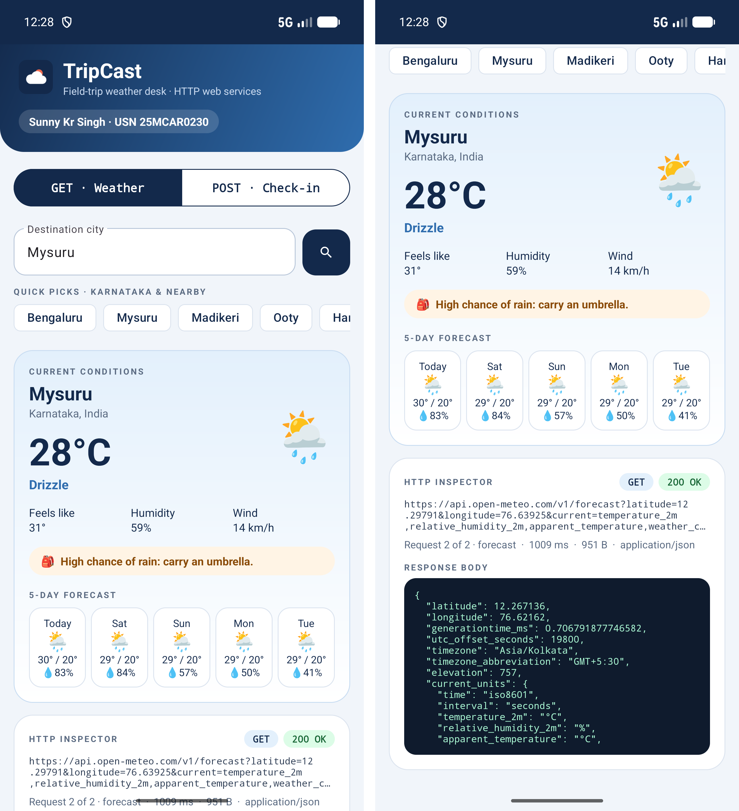
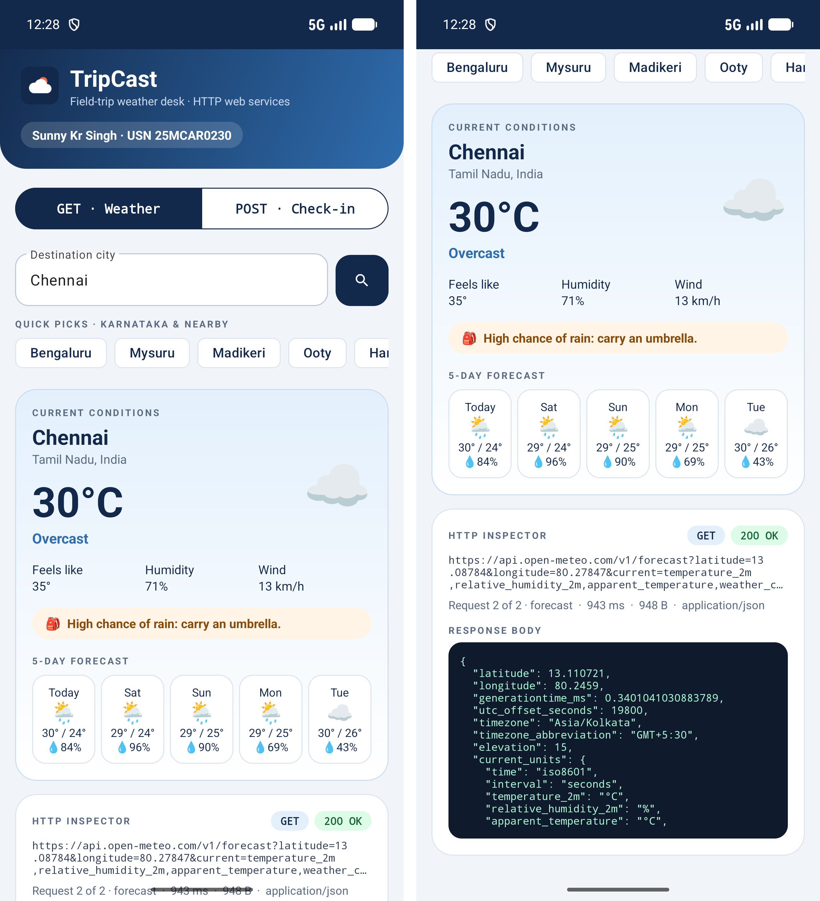
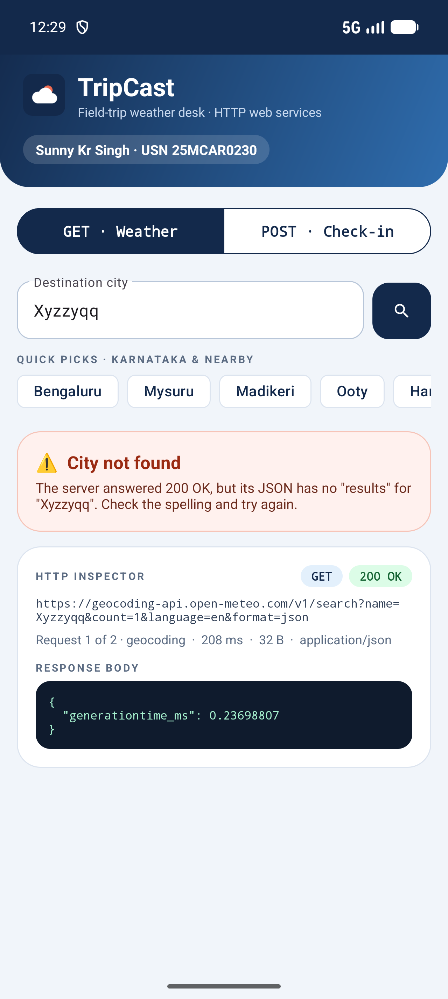
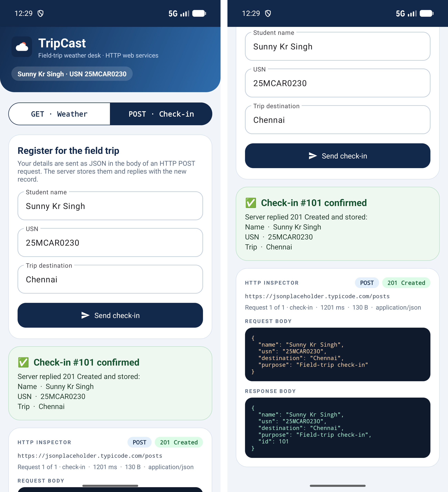

# Lab 12 — Accessing Web Services Using HTTP Requests

**Student:** Sunny Kr Singh

**USN:** 25MCAR0230

**Scenario:** TripCast — a field-trip weather desk that checks a destination's forecast with HTTP GET and registers students for the trip with HTTP POST.

## Aim

Develop an Android application that accesses **web services using HTTP requests**. The app sends real HTTP requests to public REST APIs, reads their JSON responses, and shows the result on screen. It uses **GET** to fetch a city's location and weather and **POST** to send a student check-in to a server. An on-screen *HTTP inspector* shows each request: the method, URL, status code, response time, request body and response body.

## Concept / Technology Used

- Kotlin and XML Views, following Labs 7–11.
- **`HttpURLConnection`**, the HTTP client built into Android (`java.net`). No third-party networking library is used.
- **`org.json`** (`JSONObject`, `JSONArray`), built into Android, to build request bodies and parse responses.
- A background **`ExecutorService`** for network calls, with results posted back to the UI thread through a main-thread **`Handler`**.
- Material Components: toggle button group, outlined text fields, chips and a linear progress indicator.
- Android Studio, Android Gradle Plugin 9.3.1, Gradle 9.5.0 and JDK 21. Minimum SDK 26; compile/target SDK 37.

### Web services, REST and HTTP

A **web service** is a program on a server that other programs use over the network. Most modern web services follow **REST**: each resource has a URL, the client says what it wants with an **HTTP method**, and the server answers with a **status code** and a body, usually **JSON**.

| Part of an HTTP exchange | In this app |
|---|---|
| **Method** | `GET` reads data (city lookup, forecast). `POST` sends new data (check-in). |
| **URL + query string** | `…/v1/search?name=Mysuru&count=1&language=en&format=json` |
| **Request headers** | `Accept: application/json`, plus `Content-Type: application/json; charset=UTF-8` on the POST |
| **Request body** | Only on POST: the check-in as JSON |
| **Status code** | `200 OK` for a successful GET, `201 Created` for the POST. A `4xx`/`5xx` code is shown as an error. |
| **Response body** | JSON, parsed with `org.json` and shown both as formatted data and as raw JSON in the inspector |

### Web services used

All three are free, public, and need **no API key**.

| Service | Method & endpoint | Used for |
|---|---|---|
| Open-Meteo Geocoding API | `GET https://geocoding-api.open-meteo.com/v1/search` | City name → name, state, country, latitude and longitude |
| Open-Meteo Forecast API | `GET https://api.open-meteo.com/v1/forecast` | Coordinates → current temperature, feels-like, humidity, wind, weather code and a 5-day forecast |
| JSONPlaceholder | `POST https://jsonplaceholder.typicode.com/posts` | A fake REST API for testing. It accepts the JSON body, answers `201 Created` and echoes the record back with a new `id` (always `101`; nothing is really saved). |

### How a request flows through the app

```text
Tap a city chip / search / "Send check-in"            (main thread)
        │  validate input, show progress bar
        ▼
network.execute { … }                                 (background thread)
        │  HttpClient.get(url)  or  HttpClient.postJson(url, json)
        │    ├─ openConnection() as HttpURLConnection
        │    ├─ set method, timeouts (15 s) and headers
        │    ├─ POST only: write the JSON to outputStream
        │    ├─ responseCode  → sends the request, waits for the reply
        │    └─ read inputStream (2xx) or errorStream (4xx/5xx)
        │  WebServices.parseCity / parseForecast / parseReceipt   (org.json)
        ▼
main.post { … }                                       (main thread)
        └─ update the weather / receipt / error card and the HTTP inspector
```

Getting the weather takes **two chained GET requests**: the city name is first turned into coordinates, and those coordinates are then sent to the forecast API.

### Points worth noting

- **Never on the main thread.** Android throws `NetworkOnMainThreadException` if the UI thread opens a connection, and a slow network would freeze the screen. All calls run on a single background thread, and only the main thread touches views.
- **The error stream.** For `4xx`/`5xx` responses `HttpURLConnection` puts the body on `errorStream`; reading `inputStream` would throw. `HttpClient` picks the right one.
- **Three kinds of failure are handled separately:**
  1. *No response* (offline, DNS failure, timeout) → `IOException` → *Can't reach the server*.
  2. *HTTP error status* (`4xx`/`5xx`) → *Server error &lt;code&gt;*.
  3. *Success status but unusable data* → for example a `200 OK` geocoding reply with no `results` → *City not found*. Malformed JSON → *Unexpected response*.
- **Input validation before sending.** Empty fields and USNs that do not match the `25MCAR0230` pattern are rejected on the device, so no request is sent.
- **Permission:** only `android.permission.INTERNET`. All endpoints use HTTPS, so no cleartext-traffic exception is needed.

## Scenario

**TripCast** helps a class plan a field trip:

1. The app opens on the **GET · Weather** tab. The header shows the student's name and USN.
2. The student types a destination, or taps a quick pick (*Bengaluru, Mysuru, Madikeri, Ooty, Hampi, Mangaluru*). The app looks up the city and then fetches its weather: current conditions, a 5-day forecast with rain chance, and a packing tip such as *carry an umbrella*.
3. The found city is copied into the check-in form. On the **POST · Check-in** tab the student sends their name, USN and destination. The server replies `201 Created` with the stored record and its new id, shown as a confirmation.
4. Under either tab, the **HTTP inspector** shows the last exchange: the method and status pills, the full URL, time taken, size, content type, and the request and response bodies as formatted JSON.

## Folder Structure

```text
Lab12HttpWebServicesDemo/
├── app/
│   ├── build.gradle.kts                  # Android configuration and dependencies
│   └── src/
│       ├── main/
│       │   ├── AndroidManifest.xml       # INTERNET permission and launcher activity
│       │   ├── java/com/example/lab12httpwebservicesdemo/
│       │   │   ├── MainActivity.kt       # UI, background executor, GET and POST flows, inspector, error handling
│       │   │   ├── HttpClient.kt         # HttpURLConnection wrapper: GET, POST JSON, timeouts, error stream
│       │   │   └── WebServices.kt        # Endpoint URLs, models, JSON parsing, weather-code labels
│       │   └── res/
│       │       ├── layout/
│       │       │   └── activity_main.xml # Header, GET/POST toggle, both panels, result cards, HTTP inspector
│       │       ├── drawable/             # Header gradient, card and code-block shapes, icons, launcher icon (ic_cloud)
│       │       ├── color/                # Toggle button checked/unchecked colours
│       │       ├── xml/data_extraction_rules.xml # Disables backup; the app stores nothing
│       │       └── values/
│       │           ├── strings.xml       # UI text, default student details
│       │           └── themes.xml        # Material 3 theme: navy and coral
│       └── test/java/com/example/lab12httpwebservicesdemo/
│           └── WebServicesTest.kt        # Unit tests: URL building, JSON parsing, not-found case, POST body
├── gradle/
│   ├── libs.versions.toml                # Dependency versions
│   └── wrapper/                          # Gradle wrapper JAR and properties
├── screenshots/
│   ├── output.png
│   ├── test_case_1.png
│   ├── test_case_2.png
│   └── test_case_3.png
├── .gitignore                            # Excludes builds, IDE files and SDK path
├── build.gradle.kts
├── gradle.properties
├── gradlew / gradlew.bat
├── settings.gradle.kts
└── README.md
```

## How to Run

1. Clone this repository and open **Lab12HttpWebServicesDemo** in Android Studio, rather than the repository root.
2. Use **JDK 21** for Gradle and install Android SDK Platform **37**. Android Studio creates `local.properties` for your SDK location; it is intentionally not committed.
3. Sync Gradle. The first sync needs internet to download dependencies.
4. Run on an emulator or device with Android 8.0 / API 26 or newer **and internet access**. No API key or account is needed.

From PowerShell in the project directory:

```powershell
.\gradlew.bat assembleDebug
.\gradlew.bat testDebugUnitTest
```

## Output



Tapping the **Mysuru** quick pick sends two GET requests. The left screen shows the result: *Mysuru, Karnataka, India*, 28 °C and drizzle, feels-like, humidity and wind, a rain warning and the 5-day forecast. Scrolled down (right), the HTTP inspector shows the second request, to the forecast API: **GET · 200 OK**, the full URL with its query string, about 1 s and 951 bytes of `application/json`, and the start of the JSON response.

Weather values are live data from Open-Meteo, so they will differ when you run the app.

## Test Cases

Run these from a fresh launch, **in order**. Test case 3 uses the destination found in test case 1. Every screenshot shows the student's name and USN in the header.

| Test case | Steps / input | Expected result | Screenshot |
|---|---|---|---|
| **1. GET with typed input** | On **GET · Weather**, type `Chennai` in *Destination city* and tap the search button. | Two GET requests succeed. The card shows **Chennai, Tamil Nadu, India** with its current temperature, condition, feels-like, humidity, wind, a packing tip and a 5-day forecast. The inspector shows **GET · 200 OK**, *Request 2 of 2 · forecast*, the forecast URL with Chennai's coordinates, and the JSON response. |  |
| **2. Unknown city — error handling** | Replace the text with `Xyzzyqq` and tap search. | The geocoding request succeeds with **200 OK**, but its body contains no `results`, so the forecast request is never sent. A red **City not found** card explains this. The inspector shows *Request 1 of 2 · geocoding* and the 32-byte response `{"generationtime_ms": …}`. The app does not crash. |  |
| **3. POST check-in — with name & USN** | Tap **POST · Check-in**. Keep *Sunny Kr Singh*, *25MCAR0230* and *Chennai* (copied from test case 1), and tap **Send check-in**. | The JSON body is POSTed to JSONPlaceholder, which replies **201 Created**. A green card reads **Check-in #101 confirmed** and lists the stored **Name · Sunny Kr Singh**, **USN · 25MCAR0230** and **Trip · Chennai**. The inspector shows **POST · 201 Created**, the request body that was sent and the response body with `"id": 101`. |  |

### Automated coverage

`WebServicesTest.kt` runs on the JVM, without a device or network (it uses the `org.json` library from Maven, because Android's own copy is only a stub in local unit tests):

1. Request URLs: the city name is trimmed and URL-encoded (`New Delhi` → `New+Delhi`), and the forecast URL carries the coordinates and every requested field.
2. Parsing real-shaped geocoding and forecast JSON, including a `null` rain probability, the weather-code label, the packing tip and temperature rounding.
3. A geocoding reply without `results` throws `CityNotFoundException`.
4. The check-in's JSON body contains the USN, the echoed response is parsed into a receipt with id 101, and byte sizes are formatted for the inspector.

### Verification performed

Verified on **6 November 2026**, using the **Pixel 10 Pro emulator, Android 17 / API 37**:

- Debug APK built successfully, and all **4 unit tests passed**.
- Android lint passed with no errors. The remaining warnings advise upgrading dependency versions shared with the previous labs, and suggest a `<merge>` root for the layout's outer `FrameLayout`.
- All three test cases above passed against the live web services. The PNGs are actual emulator captures at 1280 × 2856; where a result is taller than the screen, the screenshot shows the top of the screen and the scrolled-down view side by side.

```powershell
.\gradlew.bat assembleDebug testDebugUnitTest lintDebug
```

## Conclusion

This experiment accesses web services from Android with plain HTTP requests. TripCast uses `HttpURLConnection` on a background thread to send chained GET requests to the Open-Meteo REST APIs and a JSON POST to JSONPlaceholder. It parses the JSON responses with `org.json` and handles offline errors, HTTP error codes and empty results separately. The HTTP inspector shows the method, URL, status code, timing and bodies of each request, so the request–response cycle is visible inside the app.
